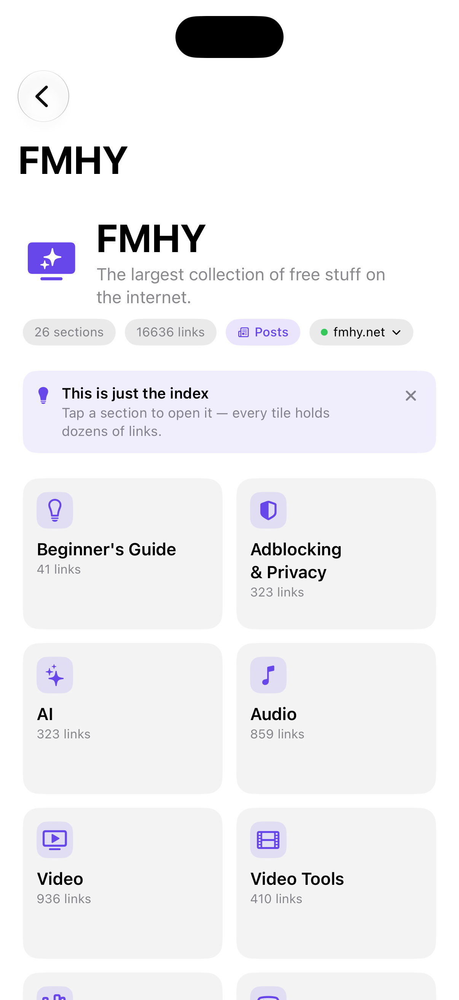
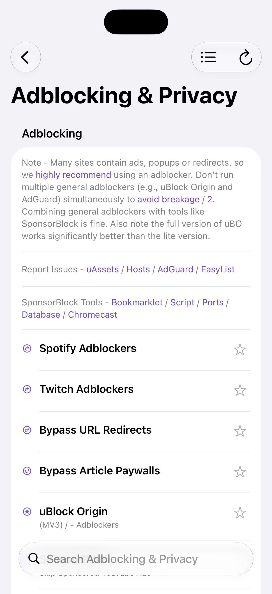
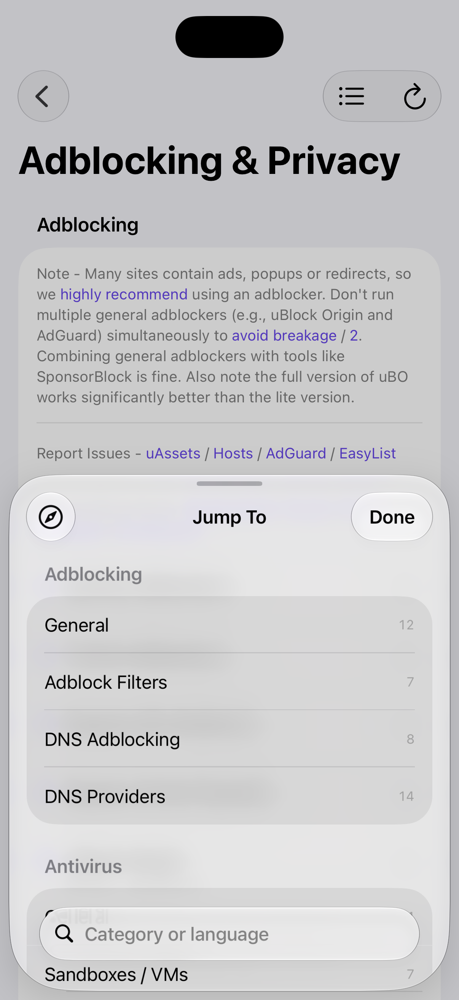
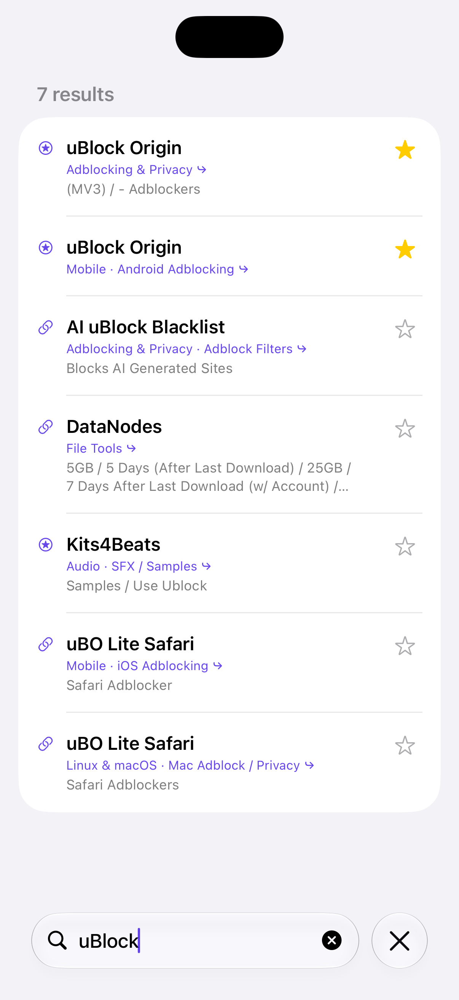
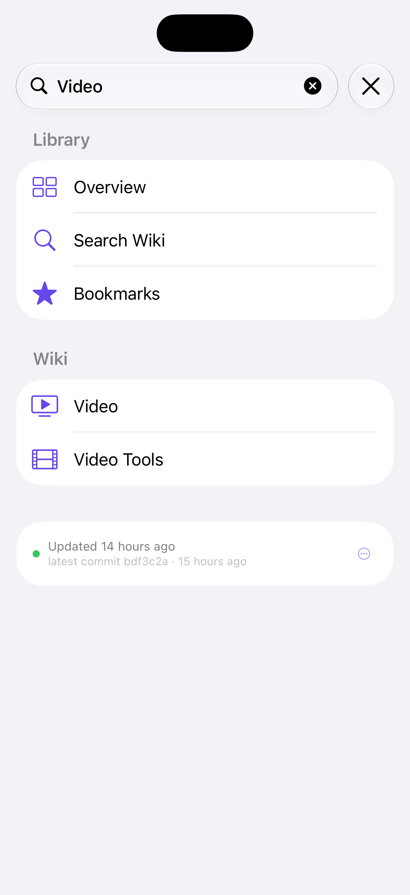
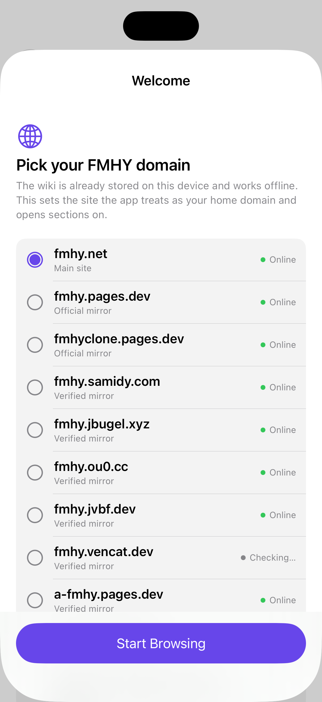

# FMHY Reader

[](https://github.com/jbgy/fmhy-reader/actions/workflows/ci.yml)
[](https://github.com/jbgy/fmhy-reader/actions/workflows/release.yml)
[](https://altdirect.app/?url=https%3A%2F%2Fraw.githubusercontent.com%2Fjbgy%2Ffmhy-reader%2Frefs%2Fheads%2Fmain%2Fdocs%2Fapps.json)
[](https://github.com/jbgy/fmhy-reader/releases/latest)


An unofficial, local-first reader for [FMHY](https://fmhy.net), the largest collection of free
stuff on the internet. This project is not affiliated with or endorsed by the FMHY team. Every section of the wiki is bundled with the app, so it opens instantly
and keeps working offline; the content then updates itself silently from the wiki's GitHub
repository.

<h3 align="center">
  <a href="https://altdirect.app/?url=https%3A%2F%2Fraw.githubusercontent.com%2Fjbgy%2Ffmhy-reader%2Frefs%2Fheads%2Fmain%2Fdocs%2Fapps.json"></a>
  &nbsp;
  <a href="https://github.com/jbgy/fmhy-reader/releases/latest"></a>
</h3>

## Screens

<p align="center">
  
  
  
</p>
<p align="center">
  
  
  
</p>

## Features

- **All 26 wiki sections**, in a sidebar on iPad and Mac and behind a four-tab bar on iPhone
  (Overview, Search, Bookmarks, Settings), with a tile overview as the start screen.
- **Local-first:** a bundled snapshot is parsed on first launch, then refreshed from
  `raw.githubusercontent.com/fmhy/edit` — no API keys, no accounts, no rate-limit surprises.
- **Silent updates:** a commit feed check on launch and on foregrounding picks up changes and
  shows what is new ("New links since the last update") without an app update.
- **Search** across every section, with a breadcrumb back to the section a result came from.
- **Bookmarks** stored on device with SwiftData: folders, one-step delete, JSON export/import, plus
  an opt-in backup copy that can refill an empty list (visible in the Files app on iOS).
- **Cross-links** to other wiki sections and to Reddit open in the app, including anchors.
- **Tappable note links** in callouts, so a recommendation's own site is one tap away.
- **Resume:** the overview lists recently viewed sections, so reading picks up where you left off.
- **Settings** in one place: appearance, automatic update checks, wiki domain and mirror fallback,
  the overview tip, the bookmark backup and the keyboard shortcut map — `⌘,` on the Mac.
- **⌘K command palette** on the Mac and iPad: one field that jumps to a section or opens any link
  in the wiki, with recent sections listed before you type.
- **Keyboard navigation** on Mac, and on iPad with a hardware keyboard: arrows move through the
  sidebar and through a section's links, ↵ opens the highlighted one.
- iPhone, iPad and Mac from one SwiftUI codebase, with light, dark and tinted icons.

## Requirements

- Xcode 27 or newer to build: the project uses Xcode's synchronized folder format.
- The app itself runs on **iOS 17 and later** and **macOS 14 and later**.
- No Apple Developer account needed to build: the app runs in the simulator and the unsigned
  `.ipa` below is re-signed by whatever sideloader you use.

## Build and run

```bash
open fmhy.xcodeproj          # then pick the fmhy scheme
```

or from the terminal:

```bash
xcodebuild -project fmhy.xcodeproj -scheme fmhy -configuration Debug \
  -destination 'generic/platform=iOS Simulator' CODE_SIGNING_ALLOWED=NO build

xcodebuild -project fmhy.xcodeproj -scheme fmhy -configuration Debug \
  -destination 'platform=macOS' CODE_SIGNING_ALLOWED=NO build
```

## Tests

```bash
xcodebuild test -project fmhy.xcodeproj -scheme fmhy -destination 'platform=macOS'
```

The suite covers the markdown parser, cross-link routing, bookmark export/import and search
ranking. CI runs it on every push.

## Install on a device

Every tagged release publishes an unsigned `.ipa`, which is what AltStore, SideStore, Feather,
ESign, Sideloadly and TrollStore expect — they re-sign it with your own certificate.

**Add the source (recommended, updates automatically):**

```
https://raw.githubusercontent.com/jbgy/fmhy-reader/refs/heads/main/docs/apps.json
```

One-tap add with [AltDirect](https://altdirect.app/?url=https%3A%2F%2Fraw.githubusercontent.com%2Fjbgy%2Ffmhy-reader%2Frefs%2Fheads%2Fmain%2Fdocs%2Fapps.json):
it offers AltStore Classic, SideStore, Feather, StikStore and TrollApps buttons. In ESign, paste
the same URL into *Sources*, or install the `.ipa` from the release page directly.

**Or build it yourself:**

```bash
./scripts/build-ipa.sh                 # build/FMHY-<version>-<build>-unsigned.ipa
./scripts/build-ipa.sh --signed TEAM   # signed with your Apple team
```

### On a Mac

There is no sideloading on macOS — every release also ships the Mac app itself as
`FMHY-macOS.zip`, attached to the same release:

```bash
curl -LO https://github.com/jbgy/fmhy-reader/releases/latest/download/FMHY-macOS.zip
unzip FMHY-macOS.zip && open FMHY.app
```

Drag `FMHY.app` into Applications to keep it, and right-click → Open the first time. If macOS
still refuses to launch it, clear the quarantine flag once:

```bash
xattr -dr com.apple.quarantine FMHY.app
```

Or build it locally:

```bash
./scripts/build-macos.sh               # build/FMHY-macOS.zip
```

## Releasing

Pushing a tag runs the whole pipeline:

```bash
git tag v1.1 && git push origin v1.1
```

`.github/workflows/release.yml` builds the unsigned IPA with `VERSION_OVERRIDE` from the tag and a
`BUILD_NUMBER_OVERRIDE` that `scripts/build-number.py` derives from the same tag (`v2.0` →
`20000`), so a release keeps its build number when a run is retried. It packages the macOS app as
`FMHY-macOS.zip`, adds the version to `docs/apps.json` (download URL, size, SHA-256, minimum OS,
plus a news entry per release), creates the GitHub release with both binaries attached, and
commits the refreshed feed back to `main` — so people who added the source get the update
through AltStore/Feather without doing anything. The same run regenerates the landing page
and the current month's post from that feed.

`ci.yml` builds iOS and macOS on every push and pull request and validates the scripts and feed.
`canary.yml` runs daily: it parses the live wiki with the app's own parser and fails when a section
loses more than a tenth of its entries or its category structure. The content is someone else's
hand-written markdown, so upstream reformatting — not a missing feature — is the failure mode that
empties a page without a single error.

## How updates work

| What | Where it comes from |
| --- | --- |
| Section list and wiki content | `fmhy/edit` on GitHub (`docs/*.md`) |
| Bundled fallback snapshot | `fmhy/Resources/WikiSeed` |
| Change notification | the repository's commit Atom feed |
| Mirror list for "open in browser" | `fmhy.net/other/backups` |

The cached content lives in the app's Application Support directory and is re-parsed when the
cache format changes. If a fetch fails the app keeps the last good copy and says so instead of
showing an empty page.

## Website

`docs/` doubles as a GitHub Pages site. `docs/index.html` is the landing page, and every month
gets a post at `/posts/<month>-<year>` — for example `/posts/nov-2026` for November 2026.
Both are generated from the entries in `docs/apps.json`, so a release shows up in its month
without hand-editing HTML:

```bash
python3 scripts/make-site.py          # rewrite the landing page and monthly posts
python3 scripts/make-site.py --check  # fail if the committed pages are stale
```

Serve it once with **Settings → Pages → Deploy from a branch → `main` / `docs`**; after that the
release workflow publishes new posts with every tag. `ci.yml` fails if the pages fall behind
the feed.

## Project layout

```
fmhy/
  Models/      wiki catalog, parsed page model, link router, bookmarks
  Services/    markdown parser and the cache/update store
  Views/       overview, section pages, search, bookmarks, setup
  Resources/   bundled wiki snapshot
fmhyTests/     parser, routing, bookmark and search tests
docs/apps.json AltStore-format source feed
docs/index.html, docs/posts/  generated landing page and monthly update posts
docs/images/  screenshots used by this README and the landing page
scripts/       IPA and macOS packaging, AltStore feed update, icon generator
```

## Credits

Wiki content belongs to the FMHY contributors; this is just a reader for it. Not affiliated with
or endorsed by the FMHY team.
